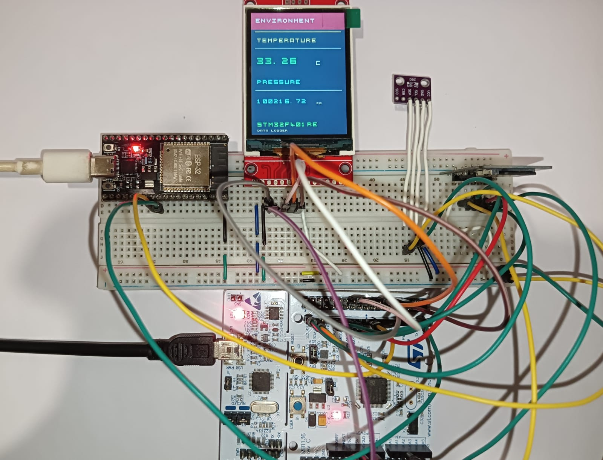
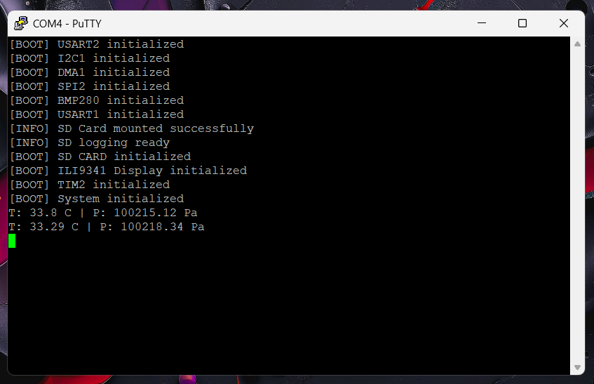
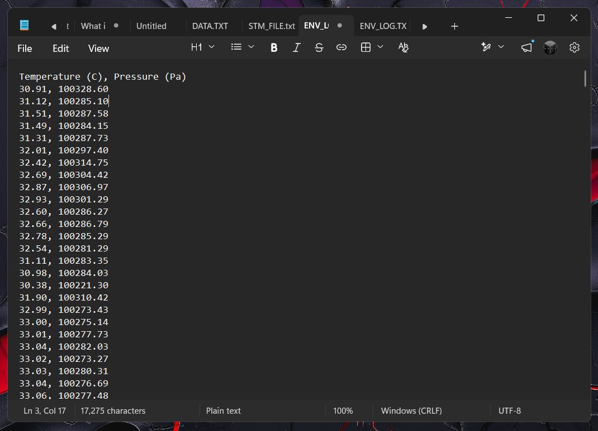
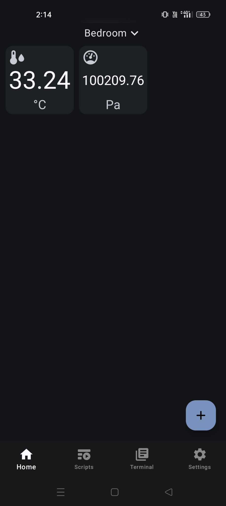
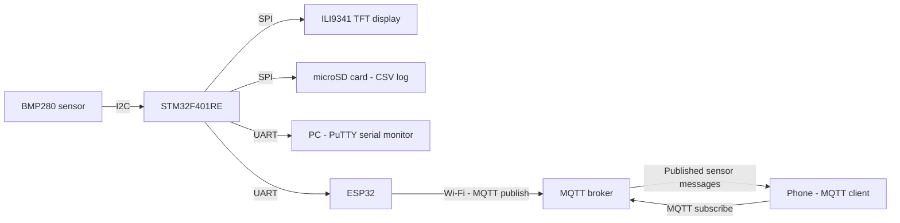

# Environmental Data Logging System

Engineered an STM32F401RE-based environmental telemetry system that acquires BMP280 temperature and pressure data at 5-second intervals using a hybrid execution model (timer scheduling, polling, interrupts, and DMA). The pipeline handles simultaneous local visualization on an ILI9341 TFT display, microSD data logging, and UART-to-ESP32 communication for publishing real-time sensor telemetry over Wi-Fi to an EMQX MQTT broker, where mobile clients subscribe for live remote monitoring.


## Hardware test images

### Project Prototype



### UART output



### SD-card CSV log



### Phone MQTT client




## Hardware

| Component | Purpose |
|---|---|
| STM32F401RE | Serves as the main host controller, orchestrating sensor acquisition, local display/storage, and UART telemetry |
| BMP280 | Measures temperature and atmospheric pressure |
| ILI9341 TFT | Displays the current readings |
| microSD card module | Stores readings in a CSV file |
| ESP32 | Sends the readings to an MQTT broker |
| PC running PuTTY | Displays the STM32 UART output during testing |
| Phone with an MQTT client | Subscribes to the MQTT broker and displays received readings |

## STM32F401RE Firmware Architecture

Built with **CMSIS** and **HAL**, the main firmware runs at an **84 MHz** system clock derived from an external **HSE** oscillator. It uses a hybrid execution model (timers, interrupts, polling, and DMA) to coordinate sensor acquisition, local visualization, storage, and serial bridging.

* **I2C Interface (BMP280):** Reads temperature and pressure data at 5-second intervals.
* **SPI2 Interface (ILI9341 TFT):** Drives the local TFT display for real-time visualization of sensor metrics.
* **SPI1 & FatFS (microSD):** Manages file-system operations to log temperature and pressure readings locally.
* **UART1 (ESP32 Bridge):** Streams formatted telemetry packets to the ESP32 co-processor for MQTT publishing.
* **UART2 (Debug Console):** Outputs system diagnostics and live status logs to a PC serial terminal (PuTTY).


## ESP32 & MQTT Telemetry Bridge

Built with the **ESP-IDF** framework, the ESP32 firmware resides in `ESP32_PUB_MQTT/`. It receives serial packets via UART and publishes live sensor readings to the EMQX MQTT broker over Wi-Fi.

* **UART Driver:** Baud rate, framing, and RX/TX pins matching the STM32 output.
* **Wi-Fi Setup:** Station (`STA`) credentials and event-driven auto-reconnect logic.
* **MQTT Client:** EMQX broker address, port, and authentication settings.
* **Topic & Payload:** Publish topic hierarchy and JSON payload schema for temperature and pressure data.

## Data flow

The STM32 is the central controller. It reads the BMP280 over I2C every 5 second, then sends the readings to the display, SD card, serial terminal, and ESP32 through their respective interfaces.



## Logged data

The SD card stores the measurements as comma-separated values. The current log format uses two columns:

```csv
Temperature (C), Pressure (Pa)
30.91, 100328.60
31.12, 100285.10
31.51, 100287.58
```


---

***Built By Amiruddin***